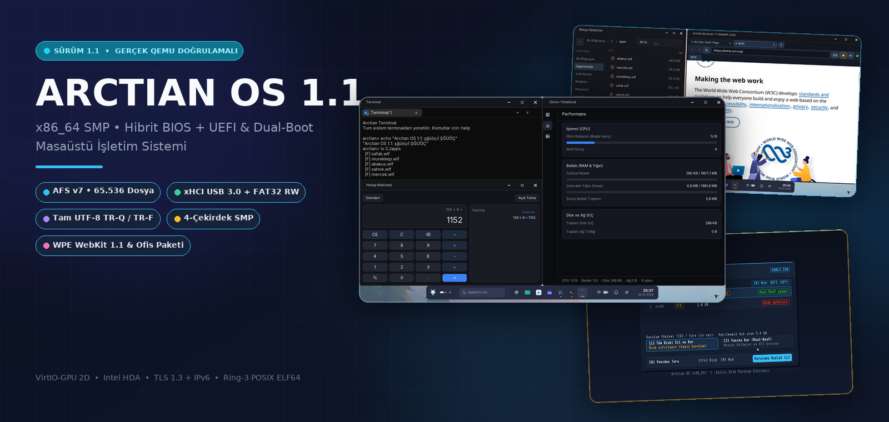

# Arctian OS 1.1

**x86_64 mimarisi için sıfırdan yazılmış, Hibrit BIOS + UEFI önyüklemeli, çok çekirdekli (SMP) masaüstü işletim sistemi.**

Kendi önyükleyicisi (MBR / El Torito / UEFI PE-COFF), kendi 64-bit çekirdeği, **65.536** dosyaya ölçeklenen çoklu-extent **AFS v7** dosya sistemi, **xHCI USB 3.0 + FAT32 RW / exFAT**, kendi **IPv4/IPv6 + TCP NewReno + TLS 1.3** ağ yığını, **VirtIO / Intel / NVIDIA / BGA (VBoxVGA/VMSVGA)** ekran sürücüleri, **Intel HDA / VirtIO-Sound / AC'97** ses + Ring-3 POSIX `/dev/dsp` altyapısı, **LVGL** tabanlı 100% UTF-8 Türkçe masaüstü kabuğu ve **Ring-3 POSIX ELF64 + `.wlf`** uygulama yalıtım katmanı tek depoda, harici bir çekirdek veya Linux katmanı olmadan sıfırdan geliştirilmiştir.

**Sürüm: 1.1** — tek kaynak: [`version.json`](version.json)

[-0ea5e9?style=for-the-badge&logo=github)](https://github.com/withermen/Arctian-OS/releases/latest)
[](docs/mimari.md)
[](LICENSE)



> **Doğrudan İndir & İncele ([GitHub Releases — `latest`](https://github.com/withermen/Arctian-OS/releases/latest)):**
> Derlemeyle uğraşmadan doğrudan önyüklenebilir **`arctian-1.1.iso`** (Hibrit BIOS + UEFI ve Dual-Boot kurulum ISO'su), **`arctian-1.1-debug.iso`** (kurulumsuz, tek komutla doğrudan masaüstüne açılan önizleme ISO'su), çalışan sistem demo videosu (**`arctian-1.1-demo.mp4`**) ve **`SHA256SUMS.txt`** dosyalarını GitHub Releases sayfasından indirebilirsiniz.
>
> *Not:* Yayın ISO'sunda (`arctian-1.1.iso`) **"Canlı Masaüstünü Dene"** (*Try Live Desktop*) düğmesi yoktur; doğrudan grafiksel BIOS/UEFI + Dual-Boot kurulum sihirbazına açılır. Kurulum yapmadan masaüstünü tek komutla görmek için **`arctian-1.1-debug.iso`** kullanın.

---

## Çalışan Sistemden Gerçek Görüntüler (QEMU)

Aşağıdaki tüm ekran görüntüleri doğrudan QEMU üzerinde çalışan Arctian OS sisteminden alınmıştır; çalışan tam video kaydı ([`arctian-1.1-demo.mp4`](https://github.com/withermen/Arctian-OS/releases/latest)) GitHub Releases sayfasında yer alır.

| Kurulum Sihirbazı (`install/`) | Masaüstü ve Çoklu Pencere Yönetimi |
|---|---|
|  |  |
| **Grafiksel BIOS/UEFI + Dual-Boot kurulum sihirbazı:** 5.0 GiB (`10.485.760` sektör) alt sınır denetimi, temiz UEFI kurulumunda GPT + 64 MB FAT32 ESP (`BOOTX64.EFI` + `KERNEL.ELF`), mevcut Windows/Linux bölümlerini koruyan **"Yanına Kur (Dual-Boot)"** modu, Türkçe bitmap font ve PS/2 fare desteği ([`install/installer.c`](install/installer.c), [`install/inst_ui.h`](install/inst_ui.h)). | **Arctian OS 1.1 masaüstü ve pencere yönetimi:** 4 adımlı OOBE ilk kurulum sihirbazı ([`desktop/oobe.h`](desktop/oobe.h)), 8 yönlü kenar/köşe pencere boyutlandırma ([`desktop/windows.c`](desktop/windows.c)), sanal masaüstleri, hızlı ayarlar, PNG ekran görüntüsü ve çoklu kullanıcı oturumları ([`desktop/main.c`](desktop/main.c)). |

| "RAM Doldu!" OOM Kurtarma Ekranı | Yerleşik Uygulamalar, Ofis & Web |
|---|---|
|  |  |
| **Güç Menüsü tarzı "RAM Doldu!" kurtarma ekranı:** Bellek kritik eşiğe ulaştığında kullanıcı/WLF/POSIX süreçlerini dondurur (`oom_freeze_apps`), RAM kullanımına göre sıralar; görev sonlandırma, sisteme dönüş (`oom_thaw_apps`) veya yeniden başlatma sunar ([`desktop/oom_ui.c`](desktop/oom_ui.c)). | **Günlük masaüstü uygulamaları ve sistem içi araçlar:** ZIP destekli Dosya Yöneticisi, Metin, Foto (PNG/JPEG/GIF/BMP), Medya (WAV/MP3/OGG/FLAC), Hesap Makinesi, Saat, Takvim, Görev Yöneticisi, ISO'da hazır kurulu 5 Ofis uygulaması (`sdk/office/`) ve yerleşik WPE WebKit 1.1 tarayıcısı ([`desktop/apps/filemanager/main.c`](desktop/apps/filemanager/main.c), [`sdk/webkit/arctian_webkit_browser.cpp`](sdk/webkit/arctian_webkit_browser.cpp)). |

---

## Kendin 30 Saniyede Test Et

[GitHub Releases](https://github.com/withermen/Arctian-OS/releases/latest) üzerinden ISO'yu indirip aşağıdaki tek satırlık komutlarla **Arctian OS 1.1**'i kendi makinenizde doğrudan başlatabilirsiniz.

### 1. QEMU (BIOS — Hızlı Masaüstü Önizlemesi veya Tam Kurulum)

**Debug ISO (`arctian-1.1-debug.iso`)** kurulumu atlayıp doğrudan masaüstünü açar; **Release ISO (`arctian-1.1.iso`)** ise en az **5.0 GiB** hedef disk üzerinde grafiksel BIOS/UEFI + Dual-Boot kurulum sihirbazını başlatır ("Canlı Masaüstünü Dene" düğmesi bulunmaz):

```sh
# Seçenek A — Hızlı önizleme (kurulum adımını atlayıp doğrudan masaüstüne açılır):
qemu-system-x86_64 -cdrom arctian-1.1-debug.iso -boot d -m 2048M -smp 4 -vga none -device virtio-gpu-pci -nic user,model=virtio-net-pci -device intel-hda -device hda-duplex -serial stdio

# Seçenek B — Release ISO ile tam grafiksel kurulum (8 GB hedef disk ile):
qemu-img create -f raw arctian-disk.img 8G && qemu-system-x86_64 -cdrom arctian-1.1.iso -drive file=arctian-disk.img,format=raw -boot d -m 2048M -smp 4 -vga none -device virtio-gpu-pci -nic user,model=virtio-net-pci -device intel-hda -device hda-duplex -serial stdio
```

### 2. QEMU (UEFI / OVMF)

`arctian-1.1.iso` çift El Torito + ISOHybrid GPT düzeniyle hem BIOS hem UEFI'den doğrudan önyüklenir (`OVMF_CODE.fd` yolu dağıtıma göre `/usr/share/OVMF/OVMF_CODE_4M.fd` veya `/usr/share/edk2/x64/OVMF_CODE.4m.fd` olabilir):

```sh
# UEFI önizleme (Debug ISO):
qemu-system-x86_64 -bios /usr/share/OVMF/OVMF_CODE_4M.fd -cdrom arctian-1.1-debug.iso -m 2048M -smp 4 -vga std -nic user,model=virtio-net-pci -serial stdio

# UEFI tam SSD/GPT+ESP kurulumu ve doğrudan UEFI diskten açılış testi:
qemu-img create -f raw arctian-uefi.img 8G && qemu-system-x86_64 -bios /usr/share/OVMF/OVMF_CODE_4M.fd -cdrom arctian-1.1.iso -drive file=arctian-uefi.img,format=raw,if=none,id=hd -device ahci,id=ahci -device ide-hd,drive=hd,bus=ahci.0 -m 2048M -smp 4 -vga std -nic user,model=virtio-net-pci -serial stdio
```

### 3. VirtualBox ve Gerçek Donanım (USB Bellek)

- **VirtualBox:** Tür olarak `Other -> Other/Unknown (64-bit)` seçin, **2 GB RAM / 2–4 CPU**, **VMSVGA** veya **VBoxVGA/VBoxSVGA** (1.1'de ilk kare `Y_OFFSET` düzeltmesi dahil), en az **6–8 GB sabit disk** oluşturun ve `arctian-1.1.iso` dosyasını optik sürücüye bağlayın (UEFI için *Enable EFI* açılabilir).
- **Gerçek PC USB (Rufus / Ventoy / `dd`):**
  - **UEFI Secure Boot Notu:** `BOOTX64.EFI` imzasız olduğu için gerçek donanımda UEFI önyüklemesi öncesinde BIOS/UEFI ayarlarından **Secure Boot**'u kapatın.
  - **Windows (Rufus):** `arctian-1.1.iso` dosyasını seçin; sorulduğunda **DD Image (DD Yansıması)** modunda yazdırın veya doğrudan **Ventoy** USB belleğine kopyalayın.
  - **Linux (`dd`):** `sudo dd if=arctian-1.1.iso of=/dev/sdX bs=4M status=progress oflag=sync`

---

## Mühendislik Kanıtı: Her Özellik Gerçek Kaynak Koduna Bağlı

Her alt sistem doğrudan bu depodaki gerçek C/C++/Assembly kaynak dosyalarıyla belgelenmiştir ve QEMU/OVMF testlerinde doğrulanmıştır.

| Alt Sistem | Uygulanan Teknik Özellik & 1.1 Yenilikleri | Gerçek Kaynak Kodu |
|---|---|---|
| **Önyükleme (BIOS + UEFI)** | Yapay bekleme/sahte boot mesajları kaldırılmış temiz MBR (`stage1.asm`), El Torito ISO + **Hibrit UEFI PE/COFF** (`BOOTX64.EFI`): OVMF GOP framebuffer (`>4 GB`), ACPI RSDP (`0x7100`), ESP'den `KERNEL.ELF` okuma, `ExitBootServices`, ISOHybrid GPT/MBR ISO | [`boot/stage1.asm`](boot/stage1.asm), [`boot/stage1_iso.asm`](boot/stage1_iso.asm), [`boot/stage2.asm`](boot/stage2.asm), [`boot/uefi/loader.c`](boot/uefi/loader.c), [`boot/uefi/elf_jump.c`](boot/uefi/elf_jump.c), [`boot/uefi/fs.c`](boot/uefi/fs.c), [`tools/arctianpack.py`](tools/arctianpack.py) |
| **UEFI Kurulum & Dual-Boot** | Temiz kurulumda GPT + **64 MB FAT32 ESP** (`BOOTX64.EFI` + `KERNEL.ELF`) ile kurulum sonrası doğrudan UEFI SSD önyükleme; mevcut Windows/Linux bölümlerini ve ESP'yi koruyan **"Yanına Kur (Dual-Boot)"** modu; Türkçe bitmap font + PS/2 fare; OOM **"RAM Doldu!"** kurtarma | [`install/installer.c`](install/installer.c), [`install/inst_ui.h`](install/inst_ui.h), [`desktop/oom_ui.c`](desktop/oom_ui.c) |
| **Girdi & Tam UTF-8 Klavye** | `TR-Q`, `TR-F`, `EN-Q` tam Unicode UTF-8 haritaları (`ğ, Ğ, ü, Ü, ş, Ş, ı, İ, ö, Ö, ç, Ç, €, ₺`), Synaptics mutlak koordinat + iki parmak kaydırma, Intel LPSS **I2C-HID** sürücüsü | [`kernel_plus/drivers/keyboard.c`](kernel_plus/drivers/keyboard.c), [`kernel_plus/drivers/mouse.c`](kernel_plus/drivers/mouse.c), [`kernel_plus/drivers/i2c_hid.h`](kernel_plus/drivers/i2c_hid.h) |
| **Depolama, AFS v7 & Şifreleme** | 1.024 dosya sınırı kaldırıldı → **65.536 dosya** kapasiteli dinamik inode bloklu + **çoklu-extent** (`EXT7`) **AFS v7** (v6 geriye uyumlu), `uid/gid/mode` çoklu kullanıcı dosya yalıtımı, GPT/MBR dinamik bölüm keşfi, `diskcrypt` AES-XTS OTA Slot B koruması; AHCI 64-PRDT & NVMe PRP-List DMA | [`lib/afs.c`](lib/afs.c), [`lib/afs.h`](lib/afs.h), [`lib/storage.c`](lib/storage.c), [`kernel_plus/system/diskcrypt.c`](kernel_plus/system/diskcrypt.c), [`lib/blk_ahci.c`](lib/blk_ahci.c), [`lib/blk_nvme.c`](lib/blk_nvme.c) |
| **USB 3.0 xHCI & Taşınabilir Diskler** | Çalışan **xHCI USB 3.0** (`qemu-xhci` doğrulamalı), USB HID klavye/fare + USB MSD; MBR/GPT bölümlü **FAT32 okuma & yazma** + UTF-8 Türkçe LFN, **exFAT okuma** ve `D:/` sıcak takma (*hot-plug*) | [`kernel_plus/drivers/usb_xhci.c`](kernel_plus/drivers/usb_xhci.c), [`kernel_plus/drivers/usb_hid.c`](kernel_plus/drivers/usb_hid.c), [`kernel_plus/drivers/usb_msd.c`](kernel_plus/drivers/usb_msd.c), [`lib/fat32.c`](lib/fat32.c), [`lib/exfat.h`](lib/exfat.h), [`kernel_plus/system/volfs.c`](kernel_plus/system/volfs.c) |
| **Bellek & Çok Çekirdek (SMP)** | Per-CPU sayfa çerçeve önbelleği, 2 MB huge page, `PAT=WC` VRAM eşlemesi, VMA bölme/birleştirme; MADT/x2APIC SMP (`-smp 4`), per-CPU run-queue + kilit-sıralı work-stealing, gerçek süreç RAM/CPU metrikleri | [`main_kernel/paging.c`](main_kernel/paging.c), [`main_kernel/vmm_space.c`](main_kernel/vmm_space.c), [`kernel_plus/system/apboot.c`](kernel_plus/system/apboot.c), [`kernel_plus/system/sched.c`](kernel_plus/system/sched.c), [`kernel_plus/system/proc.c`](kernel_plus/system/proc.c) |
| **Grafik, Ses & Laptop Güç** | VirtIO-GPU 2D, Bochs/QEMU BGA (VirtualBox `VBoxVGA`/`VMSVGA` ilk-kare `Y_OFFSET` düzeltmeli), **Intel PWM parlaklık** (`BLC_*`), NVIDIA salt okunur BAR1 WC; **Intel HDA** çok pinli jack-sense, **VirtIO-Sound** PCM ses ölçekleme, Ring-3 POSIX `/dev/dsp` akışı; ACPI SMBus BAR4 ve güvenli S3 uyku koruması | [`kernel_plus/drivers/gpu.c`](kernel_plus/drivers/gpu.c), [`kernel_plus/drivers/gpu_bga.c`](kernel_plus/drivers/gpu_bga.c), [`kernel_plus/drivers/gpu_intel.c`](kernel_plus/drivers/gpu_intel.c), [`kernel_plus/drivers/hda.c`](kernel_plus/drivers/hda.c), [`kernel_plus/drivers/virtio_snd.c`](kernel_plus/drivers/virtio_snd.c), [`kernel_plus/drivers/audio.c`](kernel_plus/drivers/audio.c), [`kernel_plus/posix/posix_fd.c`](kernel_plus/posix/posix_fd.c), [`kernel_plus/drivers/acpi.c`](kernel_plus/drivers/acpi.c) |
| **Ağ, TLS 1.3 & Gerçek PC NIC'ler** | Gerçek donanım register/DMA **RTL8169**, Intel **I225/I219-V/I226-V** + 64-bit **e1000**, VirtIO-Net, dürüst DHCP hata durumu, `ath9k` çoklu hız WPA2/CCMP, `iwl_ax201` UMAC/WPA2, **IPv4/IPv6 Dual-Stack**, TCP NewReno + OOO + RFC 7323, mbedTLS **TLS 1.3** | [`kernel_plus/drivers/rtl8169.c`](kernel_plus/drivers/rtl8169.c), [`kernel_plus/drivers/e1000.c`](kernel_plus/drivers/e1000.c), [`kernel_plus/drivers/pci.c`](kernel_plus/drivers/pci.c), [`kernel_plus/drivers/iwl_ax201.c`](kernel_plus/drivers/iwl_ax201.c), [`kernel_plus/drivers/ath9k.c`](kernel_plus/drivers/ath9k.c), [`kernel_plus/drivers/net.c`](kernel_plus/drivers/net.c), [`kernel_plus/net/tcp.c`](kernel_plus/net/tcp.c), [`kernel_plus/tls/https.c`](kernel_plus/tls/https.c) |
| **Ring-3 POSIX & `.wlf` İzolasyonu** | Linux x86-64 `SYSCALL/SYSRET`, ELF64 static-PIE yükleyici, `fork`/`execve`/`clone`/`futex`/`epoll`/`AF_UNIX`/`AF_INET`, paylaşımlı ARGB8888 pencere + pano köprüsü, **musl 1.2.5 + libstdc++ 14.2**; B3 `.wlf` Ring-3 + ayrı CR3, `uid/gid` dosya yalıtımı, UEFI ESP OTA güncellemesi | [`kernel_plus/posix/posix_syscall.c`](kernel_plus/posix/posix_syscall.c), [`kernel_plus/posix/posix_elf.c`](kernel_plus/posix/posix_elf.c), [`desktop/posix_win.c`](desktop/posix_win.c), [`kernel_plus/system/caps.c`](kernel_plus/system/caps.c), [`desktop/update.c`](desktop/update.c), [`main_kernel/wlf_user.c`](main_kernel/wlf_user.c), [`tests/posix/test_suite.cpp`](tests/posix/test_suite.cpp) |

---

## Masaüstü, Günlük Uygulamalar & Ofis Ekosistemi

Arctian OS 1.1, %100 UTF-8 Türkçe arayüzlü LVGL masaüstü kabuğu ([`desktop/main.c`](desktop/main.c)) üzerinde çalışır:

- **Masaüstü UX 1.1:** 4 adımlı **OOBE İlk Kurulum Sihirbazı** (klavye düzeni, saat dilimi, tema/vurgu rengi, masaüstü turu — [`desktop/oobe.h`](desktop/oobe.h)), 8 yönlü kenar/köşe pencere boyutlandırma ([`desktop/windows.c`](desktop/windows.c)), çoklu kullanıcı hesapları ve kilit ekranı ([`desktop/lock.c`](desktop/lock.c)), hızlı ayarlar + PNG ekran görüntüsü (`C:/ekran_XX.png` — [`desktop/quickctl.c`](desktop/quickctl.c)) ve UEFI ESP destekli OTA güncelleme ([`desktop/update.c`](desktop/update.c)).
- **Günlük Yerleşik Uygulamalar (`desktop/apps/*`):**
  - **Dosya Yöneticisi** ([`desktop/apps/filemanager/main.c`](desktop/apps/filemanager/main.c)): responsive düzen, `D:/` USB bellek erişimi ve [`lib/miniz.h`](lib/miniz.h) üzerinden PKZIP sıkıştırma/çıkarma.
  - **Metin Düzenleyici** ([`desktop/apps/metin/main.c`](desktop/apps/metin/main.c)): çoklu sekme, Kaydet/Farklı Kaydet, Geri Al/Yinele, Bul & Değiştir.
  - **Foto** ([`desktop/apps/foto/main.c`](desktop/apps/foto/main.c)): [`lib/imgdec.h`](lib/imgdec.h) ile PNG, JPEG, GIF ve BMP çözme, yakınlaştırma, 90° döndürme, slayt gösterisi.
  - **Medya Oynatıcı** ([`desktop/apps/medya/main.c`](desktop/apps/medya/main.c)): WAV, MP3, OGG ve FLAC çözme + ses, sarma ve duraklatma denetimleri.
  - **Hesap Makinesi** ([`desktop/apps/hesap/main.c`](desktop/apps/hesap/main.c)) ve **Saat / Kronometre / Zamanlayıcı** ([`desktop/apps/saat/main.c`](desktop/apps/saat/main.c)).
  - **Ayarlar** ([`desktop/apps/settings/main.c`](desktop/apps/settings/main.c)): çalışan ayar araması, kullanıcı hesabı yönetimi, ekran/klavye/ağ/güncelleme denetimleri.
  - **Görev Yöneticisi** ([`desktop/apps/taskmgr/main.c`](desktop/apps/taskmgr/main.c)): gerçek CPU/RAM/IO metrikli İşlemler ve Performans sekmeleri.
  - **Takvim** ([`desktop/apps/takvim/main.c`](desktop/apps/takvim/main.c)): kalıcı etkinlik kaydı (`C:/etc/calendar.txt`).
  - **Çöp Kovası** ([`desktop/apps/trash/main.c`](desktop/apps/trash/main.c)): silinen dosyaları özgün yoluna geri yükleme.
  - **Terminal** ([`desktop/apps/terminal/main.c`](desktop/apps/terminal/main.c)): `elfrun`, `wf`, `zip`/`unzip` ve sistem araçları.
  - **DuckStore** ([`desktop/apps/duckstore/main.c`](desktop/apps/duckstore/main.c)): birleşik HTTPS + yerleşik çevrimdışı katalog.
  - **Web Tarayıcılar:** Yerleşik HTML/CSS tarayıcı ([`desktop/apps/browser/main.c`](desktop/apps/browser/main.c)) ve ISO içinde kurulabilen **WPE WebKit 1.1** ([`sdk/webkit/arctian_webkit_browser.cpp`](sdk/webkit/arctian_webkit_browser.cpp): 8 sekmeye kadar çoklu sekme, `Ctrl+C/V` sistem panosu, canlı boyutlandırma, Türkçe UTF-8 girdi, kalıcı çerezler, yer imleri, geçmiş, `C:/indirilenler/` indirme yöneticisi, yakınlaştırma, sayfada bul).
- **ISO'ya Hazır Kurulu Ofis Paketi (`sdk/office/`):** **Şafak**, **Mürekkep**, **Abaküs**, **Sahne** ve **Mercek** `.wlf` uygulamaları kurulum sırasında `C:/apps/` altına kurulur ve ortak Aç/Farklı Kaydet dosya seçicisi ([`sdk/office/office_picker.h`](sdk/office/office_picker.h)) içerir.

---

## Kaynaktan Derleme

Windows üzerinde WSL Debian kullanarak tek adımda derlemek için:

```bat
build.bat
```

Linux / WSL üzerinde doğrudan derlemek için (`tools/build-release.sh` aracılığıyla ext4 üzerinde derleyip `build/` altına kopyalar veya doğrudan `make pack` çalıştırır):

```sh
make -j4 pack          # Release Hibrit BIOS + UEFI ISO: build/arctian.iso ve build/arctian.img
make debug             # Kurulum ve hesap ekranlarını atlayan test ISO'su: build/arctian-debug.iso
make efi               # Yalnızca UEFI önyükleyici: build/uefi/BOOTX64.EFI
```

Ayrıntılı derleme araçları, `SELFTEST=1`, `WFL_SELFTEST=1` ve QEMU test hedefleri (`test-uefi`, `test-smp`, `test-isolation`, `test-net`): [docs/derleme.md](docs/derleme.md).

---

## Kendi Uygulamanı Yazmak

**1) `.wlf` uygulaması (`libWolf`):**

```sh
cd sdk/examples/merhaba
../../wf build merhaba
```

Ofis uygulamaları (`sdk/office/`) ve üçüncü parti paketler bu yolla derlenir; sistemde `wf install <paket>` ile kurulur. SDK ayrıntıları: [sdk/README.md](sdk/README.md).

**2) C / C++20 POSIX ELF64 uygulaması (`sdk/toolchain/`):**

```sh
bash sdk/toolchain/build-toolchain.sh     # pure-musl 1.2.5 + libstdc++ 14.2 sysroot
sdk/toolchain/arctian-cxx -O2 app.cpp -o app.elf
# Arctian terminalinde:
elfrun C:/yol/app.elf
```

Pencereli Ring-3 uygulamalar için [`sdk/toolchain/include/arctian/gfx.h`](sdk/toolchain/include/arctian/gfx.h) paylaşımlı ARGB8888 tuval + pano + olay köprüsü sağlar. Gömülü API referansı: [docs/uygulama-gelistirme.md](docs/uygulama-gelistirme.md).

---

## Depo Yapısı

```
boot/          stage1 (MBR), stage1_iso (El Torito), stage2 (NASM) ve uefi/ (PE/COFF EFI)
main_kernel/   GDT/IDT, sayfalama (VMM3), vmm_space, modül yükleyici, syscall, ring3 geçişi
install/       grafiksel disk seçici (inst_ui.h), UEFI/GPT+ESP, Dual-Boot, Türkçe font & fare
kernel_plus/   drivers/ (GPU, HDA/VirtIO-Snd, xHCI/HID/MSD, RTL8169/e1000/AX201/ath9k, I2C-HID), net/, tls/, system/, posix/
desktop/       masaüstü kabuğu (LVGL), OOBE (oobe.h), oom_ui, gömülü uygulamalar, .wlf VM, posix_win köprüsü
lib/           AFS v7, FAT32 RW, exFAT RO, miniz ZIP, imgdec, blok katmanı (AHCI/NVMe/ATA), PNG/SVG, serial/klog
include/       kamu başlıkları (asi.h, app.h, wlf.h, posix_gfx.h, memory_map.h, ...)
sdk/           libWolf SDK, wf CLI, örnekler, office/ (5 uygulama + office_picker.h), toolchain/, webkit/
store/         DuckStore sunucusu (feed + web market) ve dağıtım dosyaları
tools/         arctianpack.py (Hibrit ISO/IMG + Ofis .wlf + UEFI ESP), imzalama, sig_keygen.py, build-release.sh
tests/         uefi/, smp/, isolation/ ve posix/test_suite.cpp doğrulama paketleri
design/        arayüz şartnamesi, duvar kağıdı, logo, fontlar ve açılış animasyonu görselleri
third_party/   LVGL, mbedTLS ve ürün yazılımı (bkz. third_party/README.md)
docs/          mimari, derleme, uygulama geliştirme, durum defteri, bilinen hatalar ve media/
```

---

## Belgeler

- [docs/mimari.md](docs/mimari.md) — modüller, bellek haritası, önyükleme akışı, AFS v7, `.wlf` ve Ring-3 POSIX alt sistemi
- [docs/derleme.md](docs/derleme.md) — gereken araçlar, `make` hedefleri, `sdk/toolchain/` kurulumu, ISO ve QEMU doğrulaması
- [docs/uygulama-gelistirme.md](docs/uygulama-gelistirme.md) — gömülü ASI/LVGL API'si, `.wlf` geliştirme ve Ring-3 C++20/POSIX arayüzü
- [CHANGELOG.md](CHANGELOG.md) — sürüm kayıtları (1.1 dahil)
- [docs/1.0-durum.md](docs/1.0-durum.md) — güncel 1.1 durum defteri, ölçümler ve sınırlar

---

## Bilinen Sınırlar

- **Canlı RAM masaüstü yok (Release ISO):** Release ISO (`arctian-1.1.iso`) **"Canlı Masaüstünü Dene"** (*Try Live Desktop*) düğmesi içermez; doğrudan grafiksel BIOS/UEFI + Dual-Boot kurulum sihirbazını açar. Kurulumsuz tek komutla masaüstü önizlemesi için Releases sayfasındaki **`arctian-1.1-debug.iso`** kullanılabilir.
- **UEFI Secure Boot:** `BOOTX64.EFI` imzasız olduğu için gerçek UEFI donanımda önyükleme yapmadan önce firmware ayarlarından **Secure Boot** devre dışı bırakılmalıdır.
- **WPE WebKit medya/video:** Statik `libWPEWebKit-2.0.a` derlemesinde GStreamer ve video oynatma devre dışıdır (`build_webkit_browser.sh`); buna karşılık Ring-3 POSIX `/dev/dsp` OSS PCM ses akışı yerel ve POSIX uygulamalar için çalışır.
- **Kablosuz ağ (AX201):** `ath9k` çoklu hız + WPA2/CCMP uçtan uca çalışır; Intel `iwl_ax201` UMAC tarama/WPA2 kod yolu gerçek bare-metal RF donanımında doğrulama gerektirir.
- **Yalıtım ve eşzamanlı `.wlf`:** `.wlf` ve POSIX ELF64 uygulamaları Ring-3 + ayrı CR3 (`U=0`, `W^X`) ile donanımsal yalıtımlıdır; `wolf_bridge.c` tek aktif izole `.wlf` GUI oturumu çalıştırır, masaüstü kabuğu ve gömülü uygulamalar çekirdekle aynı adres alanındadır.
- **ACPI S3 uyku:** `acpi_enter_sleep()` yalnızca geçerli bir FACS S3 waking vector (`acpi_has_valid_waking_vector()`) varsa uyku komutunu yazar; yoksa S3'ü güvenle atlar.
- **Yerel Windows araç zinciri & geliştirme anahtarları:** `.wlf` / ELF64 derlemesi Linux veya WSL üzerinden yapılır; dağıtım öncesi [`tools/sig_keygen.py`](tools/sig_keygen.py) ile yayın anahtarlarının ayrılması önerilir. Geçmiş hata taraması: [docs/bilinen-hatalar.md](docs/bilinen-hatalar.md).

---

## Lisans

CC BY 4.0 (Atıf 4.0 Uluslararası) — tam metin: [LICENSE](LICENSE). Ticari kullanım dahil her türlü kullanımda (dağıtım, kopya, değiştirilmiş sürüm) eser sahibinin bildirilmesi zorunludur: **"Arctian OS — Copyright 2026 Wither Studio/B. Kerem Örki"**.

`third_party/` altındaki kütüphaneler (LVGL MIT; mbedTLS Apache-2.0) kendi lisanslarıyla gelir; bkz. [third_party/README.md](third_party/README.md).
