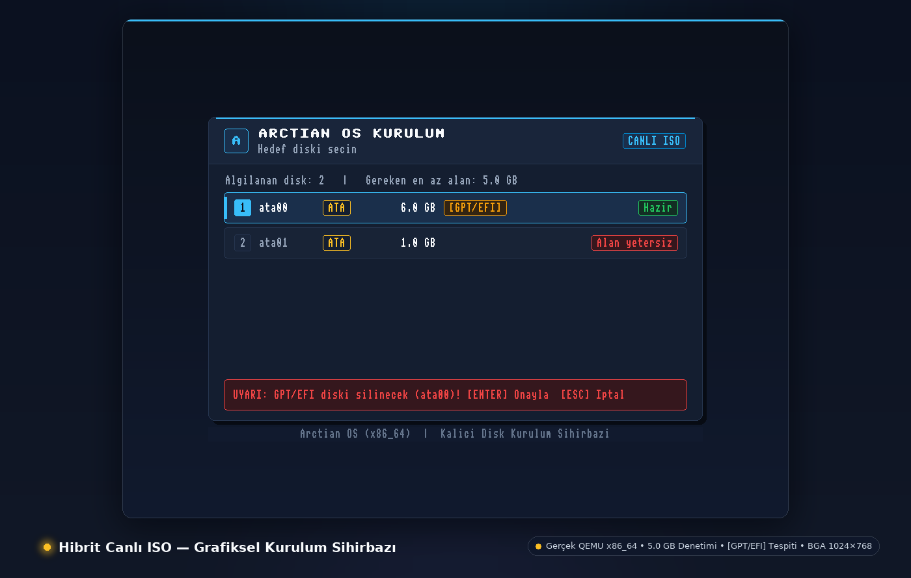
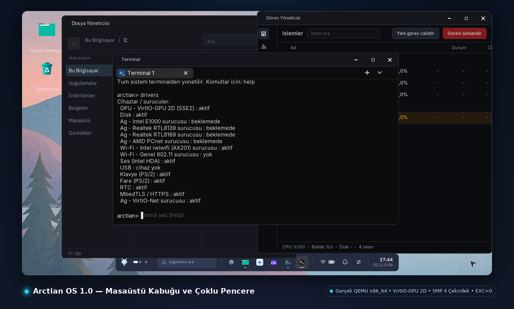
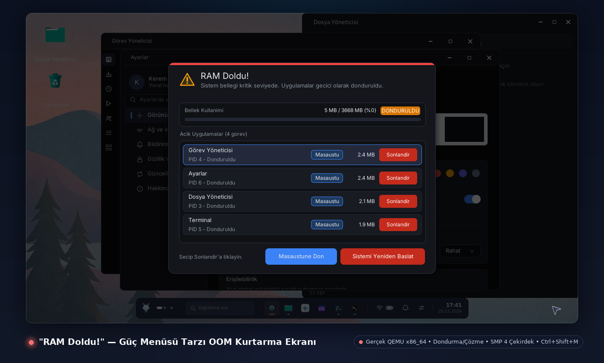
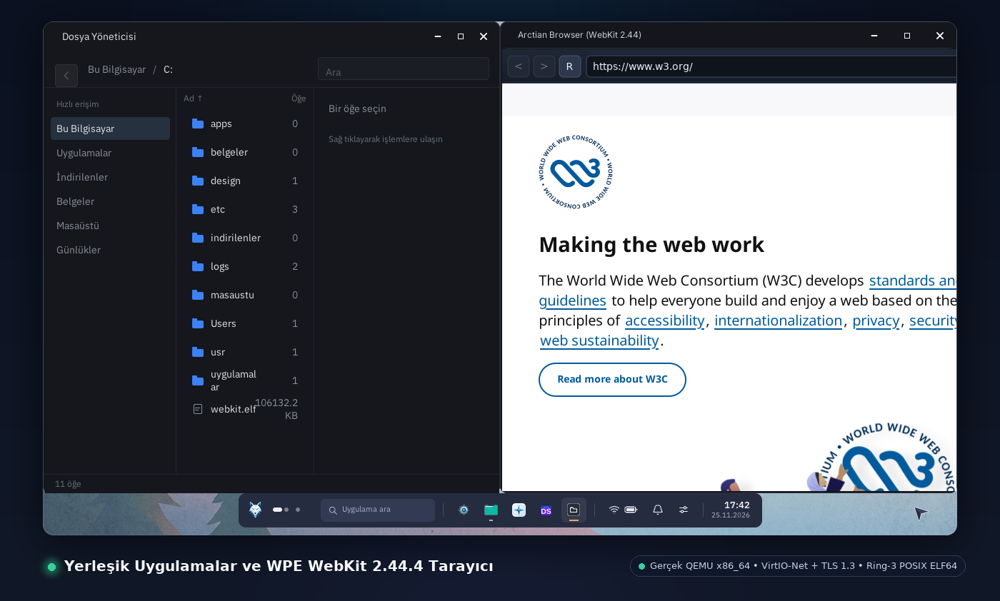

# Arctian OS 1.0

**x86_64 mimarisi için sıfırdan yazılmış, Hibrit BIOS + UEFI önyüklemeli, çok çekirdekli (SMP) masaüstü işletim sistemi.**

Kendi önyükleyicisi (MBR / El Torito / UEFI PE-COFF), kendi 64-bit çekirdeği, kendi günlüklemeli dosya sistemi (**AFS v6**), kendi **IPv4/IPv6 + TCP NewReno + TLS 1.3** ağ yığını, **VirtIO / Intel / NVIDIA / BGA** ekran sürücüleri, **Intel HDA / VirtIO-Sound / AC'97** ses altyapısı, **LVGL** tabanlı masaüstü kabuğu ve **Ring-3 POSIX ELF64 + `.wlf`** uygulama yalıtım katmanı tek depoda, harici bir çekirdek veya Linux katmanı olmadan sıfırdan geliştirilmiştir.

**Sürüm: 1.0** — tek kaynak: [`version.json`](version.json)

[-0ea5e9?style=for-the-badge&logo=github)](https://github.com/withermen/Arctian-OS/releases/latest)
[](docs/mimari.md)
[](LICENSE)


> **Doğrudan İndir & İncele ([GitHub Releases — `latest`](https://github.com/withermen/Arctian-OS/releases/latest)):**
> Derlemeyle uğraşmadan doğrudan önyüklenebilir **`arctian-1.0.iso`** (Hibrit BIOS + UEFI kurulum ISO'su), **`arctian-1.0-debug.iso`** (tek komutla doğrudan canlı masaüstüne açılan test ISO'su), çalışan sistem demo videosu (**`arctian-1.0-demo.mp4`**) ve **`SHA256SUMS.txt`** dosyalarını GitHub Releases sayfasından indirebilirsiniz.

---

## Çalışan Sistemden Gerçek Görüntüler (QEMU)

Aşağıdaki tüm ekran görüntüleri doğrudan QEMU üzerinde çalışan **Arctian OS 1.0**'dan alınmıştır; sistemin çalışan tam video kaydı ([`arctian-1.0-demo.mp4`](https://github.com/withermen/Arctian-OS/releases/latest)) GitHub Releases sayfasında yer alır.

| Kurulum Sihirbazı (`install/`) | Masaüstü ve Çoklu Pencere Yönetimi |
|---|---|
|  |  |
| **Hibrit Canlı ISO grafiksel kurulum sihirbazı:** 5.0 GB (`10.485.760` sektör) alt sınır denetimi, `[GPT/EFI]` / `[GPT]` / `[MBR]` bölüm tablosu tespiti, NVMe/SATA/AHCI/ATA/USB taraması ve canlı %0–100 kurulum + geri okuma doğrulaması ([`install/installer.c`](install/installer.c), [`install/inst_ui.h`](install/inst_ui.h)). | **Arctian OS 1.0 masaüstü ve çoklu eşzamanlı pencere yönetimi:** Dock, başlat menüsü, gerçek zamanlı arama, 10+ eşzamanlı açık pencere, sanal masaüstleri, hızlı ayarlar ve yüksek hızlı compositor ([`desktop/main.c`](desktop/main.c)). |

| "RAM Doldu!" OOM Kurtarma Ekranı | Yerleşik Uygulamalar & Web |
|---|---|
|  |  |
| **Güç Menüsü tarzı "RAM Doldu!" kurtarma ekranı:** Bellek kritik eşiğe ulaştığında kullanıcı/WLF/POSIX süreçlerini dondurur (`oom_freeze_apps`), RAM kullanımına göre sıralar; görev sonlandırma, sisteme dönüş (`oom_thaw_apps`) veya yeniden başlatma sunar ([`desktop/oom_ui.c`](desktop/oom_ui.c)). | **Yerleşik masaüstü uygulamaları ve sistem içi modern web tarayıcısı:** Dosya Yöneticisi, Terminal, Görev Yöneticisi, Metin Düzenleyici, Medya Oynatıcı, sistem araçları ve WPE WebKit destekli tarayıcı penceresi ([`desktop/apps/filemanager/main.c`](desktop/apps/filemanager/main.c), [`desktop/apps/browser/main.c`](desktop/apps/browser/main.c)). |

---

## Kendin 30 Saniyede Test Et

[GitHub Releases](https://github.com/withermen/Arctian-OS/releases/latest) üzerinden ISO'yu indirip aşağıdaki tek satırlık komutlarla **Arctian OS 1.0**'ı kendi makinenizde doğrudan başlatabilirsiniz.

### 1. QEMU (BIOS — Tam Kurulum Akışı veya Hızlı Masaüstü)

**Release ISO (`arctian-1.0.iso`)** en az **5.0 GB** hedef disk üzerinde grafiksel kurulum sihirbazını açar; **Debug ISO (`arctian-1.0-debug.iso`)** ise kurulumu atlayıp doğrudan masaüstünü gösterir:

```sh
# Seçenek A — Hızlı önizleme (kurulum adımını atlayıp doğrudan masaüstüne açılır):
qemu-system-x86_64 -cdrom arctian-1.0-debug.iso -boot d -m 2048M -smp 4 -vga none -device virtio-gpu-pci -nic user,model=virtio-net-pci -device intel-hda -device hda-duplex -serial stdio

# Seçenek B — Release ISO ile tam grafiksel kurulum (6 GB hedef disk ile):
qemu-img create -f raw arctian-disk.img 6G && qemu-system-x86_64 -cdrom arctian-1.0.iso -drive file=arctian-disk.img,format=raw -boot d -m 2048M -smp 4 -vga none -device virtio-gpu-pci -nic user,model=virtio-net-pci -device intel-hda -device hda-duplex -serial stdio
```

### 2. QEMU (UEFI / OVMF)

`arctian-1.0.iso` çift El Torito + ISOHybrid GPT düzeniyle hem BIOS hem UEFI'den doğrudan önyüklenir (`OVMF_CODE.fd` yolu Linux'ta `/usr/share/OVMF/OVMF_CODE_4M.fd` veya `/usr/share/edk2/x64/OVMF_CODE.4m.fd` olabilir):

```sh
qemu-system-x86_64 -bios /usr/share/OVMF/OVMF_CODE_4M.fd -cdrom arctian-1.0-debug.iso -m 1024M -smp 4 -vga std -nic user,model=virtio-net-pci -serial stdio
```

### 3. VirtualBox ve Gerçek Donanım (USB Bellek)

- **VirtualBox:** Tür olarak `Other -> Other/Unknown (64-bit)` seçin, **2 GB RAM / 2–4 CPU**, **VMSVGA** veya **VBoxSVGA**, en az **6 GB sabit disk** oluşturun ve `arctian-1.0.iso` dosyasını optik sürücüye bağlayın (UEFI için *Enable EFI* seçeneğini açabilirsiniz).
- **Gerçek PC USB (Rufus / Ventoy / `dd`):**
  - **Windows (Rufus):** `arctian-1.0.iso` dosyasını seçin; sorulduğunda **DD Image (DD Yansıması)** modunda yazdırın veya doğrudan **Ventoy** USB belleğine kopyalayın.
  - **Linux (`dd`):** `sudo dd if=arctian-1.0.iso of=/dev/sdX bs=4M status=progress oflag=sync`

---

## Mühendislik Kanıtı: Her Özellik Gerçek Kaynak Koduna Bağlı

Her alt sistem doğrudan bu depodaki gerçek C/Assembly kaynak dosyalarıyla belgelenmiştir ve QEMU/OVMF testlerinde doğrulanmıştır (`EXC=0`).

| Alt Sistem | Uygulanan Teknik Özellik & Ölçüm | Gerçek Kaynak Kodu |
|---|---|---|
| **Önyükleme (BIOS + UEFI)** | MBR + El Torito ISO + **Hibrit UEFI PE/COFF** (`BOOTX64.EFI`): OVMF'de GOP framebuffer, ACPI RSDP (`0x7100`), ESP'den `KERNEL.ELF` okuma, `ExitBootServices`, 1 GB/2 MB kimlik haritası ve tek komutta ISOHybrid GPT/MBR ISO üretimi | [`boot/stage1.asm`](boot/stage1.asm), [`boot/stage1_iso.asm`](boot/stage1_iso.asm), [`boot/stage2.asm`](boot/stage2.asm), [`boot/uefi/loader.c`](boot/uefi/loader.c), [`boot/uefi/elf_jump.c`](boot/uefi/elf_jump.c), [`boot/uefi/fs.c`](boot/uefi/fs.c), [`tools/arctianpack.py`](tools/arctianpack.py) |
| **Kurulum & OOM Kurtarma** | NVMe/SATA/AHCI/ATA/USB taraması, 5.0 GB (`10.485.760` sektör) alt sınır kontrolü, `[GPT/EFI]`/`[GPT]`/`[MBR]` tespiti, %0–100 MB ilerleme + geri okuma doğrulaması; bellek kritik sınırda Güç Menüsü tarzı **"RAM Doldu!"** dondurma/sonlandırma ekranı | [`install/installer.c`](install/installer.c), [`install/inst_ui.h`](install/inst_ui.h), [`desktop/oom_ui.c`](desktop/oom_ui.c) |
| **Bellek Yönetimi (VMM3)** | Per-CPU sayfa çerçeve önbelleği (magazine), dinamik refcount, `>1 GB` RAM için 2 MB huge page, `PAT=WC` VRAM eşlemesi, 256 GB'a kadar `PROT_NONE`/`MAP_NORESERVE` rezervasyon, demand-zero `#PF`, VMA bölme/birleştirme, `mremap`/`madvise(MADV_DONTNEED)`, ISR/syscall `fxsave`/`fxrstor` | [`main_kernel/paging.c`](main_kernel/paging.c), [`main_kernel/vmm_space.c`](main_kernel/vmm_space.c), [`main_kernel/isr.asm`](main_kernel/isr.asm), [`kernel_plus/posix/posix_vm.c`](kernel_plus/posix/posix_vm.c) |
| **Çok Çekirdek (SMP)** | MADT/x2APIC topoloji keşfi, 16→32→64-bit AP trampoline, per-CPU GDT/TSS/IDT, per-CPU run-queue ve kilit-sıralı **work-stealing** (`steal_runq_locked`), spinlock/mutex/semafor/pipe/mq ve IRQ-güvenli seri konsol (`-smp 4`, `EXC=0`) | [`kernel_plus/system/apboot.c`](kernel_plus/system/apboot.c), [`kernel_plus/system/ap_trampoline.asm`](kernel_plus/system/ap_trampoline.asm), [`kernel_plus/system/sched.c`](kernel_plus/system/sched.c), [`kernel_plus/system/proc.c`](kernel_plus/system/proc.c) |
| **Grafik & GPU Sürücüleri** | Modüler `gpu_drv_t` + PCI Display tarayıcı; **VirtIO-GPU 2D** (`0x1AF4:0x1050`, Modern PCI + 2D komut kuyruğu, **8.300–10.416 MB/sn**, `EXC=0`), **Bochs/QEMU BGA** (4K `3840×2160×32` + `Y_OFFSET` page-flip, **781 MB/sn**), **Intel UHD/Iris Xe/Arc** (`PIPE_FRMCOUNT` VBlank + `PLANE_SURF` flip + BCS 2D blitter), **NVIDIA GeForce RTX 20–50** (salt okunur `NV_PMC_BOOT_0` + BAR1 WC), SSE2/AVX2 (`movntdq`/`vmovntdq`) blitter | [`kernel_plus/drivers/gpu.c`](kernel_plus/drivers/gpu.c), [`kernel_plus/drivers/gpu_virtio.c`](kernel_plus/drivers/gpu_virtio.c), [`kernel_plus/drivers/gpu_bga.c`](kernel_plus/drivers/gpu_bga.c), [`kernel_plus/drivers/gpu_intel.c`](kernel_plus/drivers/gpu_intel.c), [`kernel_plus/drivers/gpu_nvidia.c`](kernel_plus/drivers/gpu_nvidia.c), [`kernel_plus/drivers/gpu_simd.c`](kernel_plus/drivers/gpu_simd.c) |
| **Depolama & Dosya Sistemi** | **AHCI** (64-PRDT scatter-gather DMA, komut başına 256 KiB), **NVMe** (64-bit PRP1/PRP2/PRP-List DMA), ATA/ATAPI/USB MSD; **AFS v6** (`C:/`, 1024 dosya yuvası, 256-sektor metadata günlükleme, serbest alan birleştirme, 255B uzun yol, `fsck`), FAT32, ISO9660 | [`lib/blk_ahci.c`](lib/blk_ahci.c), [`lib/blk_nvme.c`](lib/blk_nvme.c), [`lib/blockdev.c`](lib/blockdev.c), [`lib/afs.c`](lib/afs.c), [`lib/fat32.c`](lib/fat32.c), [`lib/iso9660.c`](lib/iso9660.c) |
| **Ses & Çevre Birimleri** | **Intel HDA** (CORB/RIRB + BDL DMA, dinamik sayfa tahsisi), **VirtIO-Sound** (`0x1AF4:0x1059` controlq + PCM TX kuyruğu), **AC'97** ve PC Speaker yedeği; USB UHCI/EHCI/XHCI + HID + MSD, PS/2, CMOS RTC (IRQ-güvenli), ACPI güç yönetimi | [`kernel_plus/drivers/audio.c`](kernel_plus/drivers/audio.c), [`kernel_plus/drivers/hda.c`](kernel_plus/drivers/hda.c), [`kernel_plus/drivers/virtio_snd.c`](kernel_plus/drivers/virtio_snd.c), [`kernel_plus/drivers/ac97.c`](kernel_plus/drivers/ac97.c), [`kernel_plus/drivers/acpi.c`](kernel_plus/drivers/acpi.c) |
| **Ağ & TLS 1.3 Yığını** | **VirtIO-Net** (`0x1AF4:0x1041`/`0x1000` Split Virtqueue), e1000 (toplu RDT/ITR), RTL8139/8169, PCnet, Wi-Fi (ath9k + AX201); **IPv4 + IPv6 Dual-Stack** (SLAAC EUI-64, ICMPv6, NDP), **TCP NewReno (IW10)** + dinamik **OOO** birleştirme + RFC 7323 pencere ölçekleme (**4 MB HTTP 1,11 sn / 3,77 MB/sn**), UDP/DHCP/DNS/NTP, güvenlik duvarı, **mbedTLS TLS 1.3** (AES-NI algılamalı) | [`kernel_plus/drivers/virtio_net.c`](kernel_plus/drivers/virtio_net.c), [`kernel_plus/drivers/net.c`](kernel_plus/drivers/net.c), [`kernel_plus/net/ipv4.c`](kernel_plus/net/ipv4.c), [`kernel_plus/net/ipv6.c`](kernel_plus/net/ipv6.c), [`kernel_plus/net/tcp.c`](kernel_plus/net/tcp.c), [`kernel_plus/tls/https.c`](kernel_plus/tls/https.c) |
| **Ring-3 POSIX & `.wlf` İzolasyonu** | Linux x86-64 `SYSCALL/SYSRET` ABI, >40 MB akışlı ELF64 static-PIE yükleyici, `fork`/`execve`/`clone`/`futex`/`epoll`/`AF_UNIX`/`AF_INET`, paylaşımlı ARGB8888 pencere köprüsü, **musl 1.2.5 + libstdc++ 14.2 (C++20)** araç zinciri (`23/23 PASS`, `EXC=0`); **B3 `.wlf`** Ring-3 + ayrı CR3 (`W^X`, 94-API `wolf_api_t` trampoline); yetenek kapıları ve RSA-2048/SHA-256 imzalı güncelleme | [`kernel_plus/posix/posix_syscall.c`](kernel_plus/posix/posix_syscall.c), [`kernel_plus/posix/posix_elf.c`](kernel_plus/posix/posix_elf.c), [`kernel_plus/posix/posix_proc.c`](kernel_plus/posix/posix_proc.c), [`kernel_plus/posix/posix_sock.c`](kernel_plus/posix/posix_sock.c), [`kernel_plus/posix/posix_gfx.c`](kernel_plus/posix/posix_gfx.c), [`desktop/posix_win.c`](desktop/posix_win.c), [`main_kernel/wlf_user.c`](main_kernel/wlf_user.c), [`tests/posix/test_suite.cpp`](tests/posix/test_suite.cpp) |

---

## Masaüstü ve Yerleşik Uygulamalar

Arctian OS, LVGL tabanlı modern bir masaüstü kabuğu ([`desktop/main.c`](desktop/main.c)) üzerinde çalışır: dock, başlat menüsü, gerçek zamanlı arama, taşıma/yakınlaştırma/ekranı kaplama ve geometri hatırlamalı pencereler, sanal masaüstleri, hızlı ayarlar + OSD, bildirim merkezi, gece modu, çoklu kullanıcı hesabı ve iki ekranlı giriş/kilit arayüzü sunar.

- **Yerleşik Uygulamalar:** Dosya Yöneticisi, Terminal (`elfrun` ve `wf` CLI destekli), Görev Yöneticisi, Metin Düzenleyici, Medya Oynatıcı, Fotoğraf Görüntüleyici, Takvim, Ayarlar, Sistem Araçları, Çöp Kovası, Asistan, DuckStore ve sistem içi modern web tarayıcısı (yerleşik motor + WPE WebKit 2.44.4 desteği).
- **Ofis Paketi & Paket Ekosistemi:** Şafak, Mürekkep, Abaküs, Sahne ve Mercek (`.wlf` paketleri, Ring-3 + ayrı CR3 yalıtımı) ile C/C++20 static-PIE POSIX ELF64 uygulamaları.

---

## Kaynaktan Derleme

Windows üzerinde WSL Debian kullanarak tek adımda derlemek için:

```bat
build.bat
```

Linux / WSL üzerinde doğrudan derlemek için (`tools/build-release.sh` aracılığıyla ext4 üzerinde derleyip `build/` altına kopyalar veya doğrudan `make pack` çalıştırır):

```sh
make -j4 pack          # Release Hibrit BIOS + UEFI ISO: build/arctian.iso ve build/arctian.img
make debug             # Kurulumu atlayan hızlı test ISO'su: build/arctian-debug.iso
make efi               # Yalnızca UEFI önyükleyici: build/uefi/BOOTX64.EFI
```

Ayrıntılı derleme araçları, `SELFTEST=1`, `WFL_SELFTEST=1` ve QEMU test hedefleri (`test-uefi`, `test-smp`, `test-isolation`, `test-net`): [docs/derleme.md](docs/derleme.md).

---

## Kendi Uygulamanı Yazmak

**1) `.wlf` uygulaması (`libWolf`):**

```sh
cd sdk/examples/merhaba
../../wf build merhaba
```

Ofis uygulamaları (`sdk/office/`) ve üçüncü parti paketler bu yolla derlenir; sistemde `wf install <paket>` ile kurulur. SDK ayrıntıları: [sdk/README.md](sdk/README.md).

**2) C / C++20 POSIX ELF64 uygulaması (`sdk/toolchain/`):**

```sh
bash sdk/toolchain/build-toolchain.sh     # pure-musl 1.2.5 + libstdc++ 14.2 sysroot
sdk/toolchain/arctian-cxx -O2 app.cpp -o app.elf
# Arctian terminalinde:
elfrun C:/yol/app.elf
```

Pencereli Ring-3 uygulamalar için `sdk/toolchain/include/arctian/gfx.h` paylaşımlı ARGB8888 tuval + olay köprüsü sağlar. Gömülü API referansı: [docs/uygulama-gelistirme.md](docs/uygulama-gelistirme.md).

---

## Depo Yapısı

```
boot/          stage1 (MBR), stage1_iso (El Torito), stage2 (NASM) ve uefi/ (PE/COFF EFI)
main_kernel/   GDT/IDT, sayfalama (VMM3), vmm_space, modül yükleyici, syscall, ring3 geçişi
install/       grafiksel disk seçici (inst_ui.h), 5 GB/GPT tespiti, %0–100 ilerleme ve doğrulama
kernel_plus/   drivers/ (VirtIO-GPU/Intel/NVIDIA/BGA, HDA/VirtIO-Snd/AC97, VirtIO-Net/e1000), net/ (IPv4/IPv6/TCP), tls/, system/ (SMP), posix/
desktop/       masaüstü kabuğu (LVGL), oom_ui ("RAM Doldu!"), gömülü uygulamalar, .wlf yükleyici/VM, posix_win köprüsü
lib/           AFS v6, FAT32, ISO9660, blok katmanı (AHCI/NVMe/ATA), ses/medya, PNG/SVG, malloc, serial/klog
include/       kamu başlıkları (asi.h, app.h, wlf.h, posix_gfx.h, memory_map.h, ...)
sdk/           libWolf SDK, wf CLI, örnekler, office/, toolchain/ (musl + C++20) ve webkit/
store/         DuckStore sunucusu (feed + web market) ve dağıtım dosyaları
tools/         arctianpack.py (Hibrit ISO/IMG), imzalama, sig_keygen.py, build-release.sh, görsel araçlar
tests/         uefi/, smp/, isolation/ ve posix/test_suite.cpp doğrulama paketleri
design/        arayüz şartnamesi, duvar kağıdı, logo, fontlar ve açılış animasyonu görselleri
third_party/   LVGL, mbedTLS ve ürün yazılımı (bkz. third_party/README.md)
docs/          mimari, derleme, uygulama geliştirme, durum defteri, yol haritası ve media/
```

---

## Belgeler

- [docs/mimari.md](docs/mimari.md) — modüller, bellek haritası, önyükleme akışı, AFS v6, `.wlf` ve Ring-3 POSIX alt sistemi
- [docs/derleme.md](docs/derleme.md) — gereken araçlar, `make` hedefleri, `sdk/toolchain/` kurulumu, ISO ve QEMU doğrulaması
- [docs/uygulama-gelistirme.md](docs/uygulama-gelistirme.md) — gömülü ASI/LVGL API'si, `.wlf` geliştirme ve Ring-3 C++20/POSIX arayüzü
- [CHANGELOG.md](CHANGELOG.md) — sürüm kayıtları
- [docs/1.0-durum.md](docs/1.0-durum.md) — güncel hat bazında durum, ölçümler ve sınırlar

---

## Bilinen Sınırlar

- **Yalıtım modeli:** `.wlf` ve POSIX ELF64 uygulamaları Ring-3 + ayrı CR3 adres alanında (`U=0` çekirdek, `W^X`) donanımsal olarak yalıtılmıştır. `.wlf` tarafında tek aktif izole GUI oturumu ve poll tabanlı broker kuyruğu kullanılır; masaüstü kabuğu ve gömülü uygulamalar tasarım gereği çekirdekle aynı adres alanındadır.
- **GPU kapsamı:** VirtIO-GPU 2D ve Bochs BGA hızlandırmalıdır; Intel sürücüsü açık PRM VBlank/page-flip/BCS yollarını kullanır; NVIDIA GeForce RTX 20–50 sürücüsü ise imzalı GSP/Falcon 3D gölgelendiricileri olmadan salt okunur `NV_PMC_BOOT_0` tespiti ve güvenli BAR1 WC + SIMD 2D yolu sunar.
- **Kablosuz ağ & ses donanımı:** Kablolu tarafta VirtIO-Net, e1000, PCnet ve RTL8139/RTL8169 desteklenir; kablosuz tarafta ath9k uçtan uca çalışır, Intel AX201 ürün yazılımını yükler ancak tarama/bağlantı adımları gerçek donanımda doğrulanmamıştır.
- **Canlı RAM masaüstü yok (Release ISO):** Release ISO (`arctian-1.0.iso`) grafiksel kurulum sihirbazı ile en az 5.0 GB hedef diske kurulum yapar; kurulumsuz doğrudan masaüstü denemek için Releases sayfasındaki `arctian-1.0-debug.iso` kullanılabilir.
- **Yerel Windows araç zinciri & geliştirme anahtarları:** `.wlf` / ELF64 derlemesi Linux veya WSL üzerinden yapılır. Geliştirme RSA-2048 anahtarı [`tools/sig_keygen.py`](tools/sig_keygen.py) ile üretilir; dağıtım öncesi yayın anahtarlarının ayrılması önerilir.
- Geçmiş hata taraması: [docs/bilinen-hatalar.md](docs/bilinen-hatalar.md).

---

## Lisans

CC BY 4.0 (Atıf 4.0 Uluslararası) — tam metin: [LICENSE](LICENSE). Ticari kullanım dahil her türlü kullanımda (dağıtım, kopya, değiştirilmiş sürüm) eser sahibinin bildirilmesi zorunludur: **"Arctian OS — Copyright 2026 Wither Studio/B. Kerem Örki"**.

`third_party/` altındaki kütüphaneler (LVGL MIT; mbedTLS Apache-2.0) kendi lisanslarıyla gelir; bkz. [third_party/README.md](third_party/README.md).
